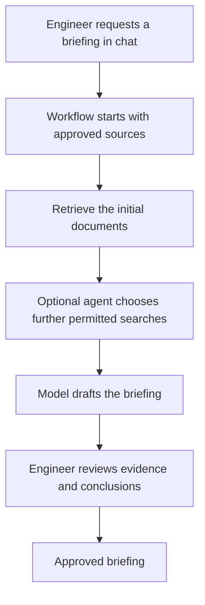

---

layout: post

title: "Model vs. Chatbot vs. Workflow vs. Agent"
subtitle: "Separate the Model, the Interface, and the Decisions a System Can Make"
quote: "The chat window tells you how you interact with a system. The control logic tells you what it can decide and do."
excerpt: "Models, chatbots, workflows, and agents describe different parts of an AI system. One maintenance-briefing example makes the boundaries easier to see."
source: "Original Content"
source-url: ""
call-to-action: "Discuss on Mastodon"

date: 2025-09-11 05:00:00 -0700
update: 2025-09-11 05:00:00 -0700

author:
    avatar: https://secure.gravatar.com/avatar/a76b4d6291cecb3a738896a971bfb903?s=512\&d=mp\&r=g
    name: Ted Tschopp
    url: https://tedt.org/

bullets:
- "A model supplies a learned capability; a chatbot supplies a conversational interface."
- "A workflow defines the process, which may include variable model outputs."
- "An agent chooses steps in response to observations within delegated limits."
- "Tool use, memory, and continuous learning are separate design choices."
- "A practical example, diagram, and compact notation show how the concepts fit together."

description: "Understand models, chatbots, workflows, and agents through a practical example, a diagram, and precise distinctions about control and tool use."
seo-description: "Model vs. chatbot vs. workflow vs. agent: clear definitions, one enterprise example, and the decisions that determine system autonomy."

categories:
  - AI

tags:
  - ai
  - models
  - chatbots
  - workflows
  - agents
  - llms
  - automation
  - autonomy
  - computer science
  - governance

keywords:
  - chatbot definition
  - workflow vs agent
  - autonomous agents
  - llm chatbot
  - ai terminology
  - computer science definitions
  - language model
  - agent autonomy
  - workflow automation

location:
    name: Bradbury, CA
    coordinates:
        latitude: 34.1470
        longitude: -117.9709

image: "img/2025-09/AI-Model-Chatbot-Workflow-Agent.webp"
image-alt: "Diagram showing differences between model, chatbot, workflow, and agent"
image-artist: "Ted Tschopp"
image-artist-URL: https://tedt.org
image-credits: "Ted Tschopp"
image-credits-URL: https://tedt.org
image-credits-artist: "Ted Tschopp"
image-credits-artist-URL: 
image-credits-title: "Model vs. Chatbot vs. Workflow vs. Agent Diagram"
image-description: "A diagram illustrating the relationships and distinctions between models, chatbots, workflows, and agents."
image-title: "Model vs. Chatbot vs. Workflow vs. Agent"
image_width:
image_height:

mastodon-post-id: 115186286978010327

math: true
mermaid: true
no_toc: true
---

A model, a chatbot, a workflow, and an agent can all be parts of the same application. The terms become useful when each answers a different question: what capability is available, how someone interacts with it, how the process is organized, and who chooses the next step.

Start with a simple request: **prepare a maintenance briefing from approved documents**. The examples below are possible designs, rather than descriptions of a deployed utility system.

## Four Concepts, Four Questions

| Concept | Meaning and Example |
| --- | --- |
| **Model** | A learned mapping from inputs to outputs. Here, a language model produces a proposed summary from supplied material. |
| **Chatbot** | A conversational interface and its application, which may use retrieval, tools, and conversation history. Here, an engineer asks for a briefing and requests a revision. |
| **Workflow** | A process with predefined steps and transitions, which may include AI. Here, it retrieves documents, drafts, checks required fields, and routes the result to a reviewer. |
| **Agent** | A system that selects actions toward a goal using observations and feedback, within assigned authority. Here, it chooses which approved source to inspect when a question remains unanswered. |
{: .well .table .table-striped}

These are working definitions. In particular, the industry uses *agent* for several different designs. Anthropic's [December 2024 article on effective agents](https://www.anthropic.com/engineering/building-effective-agents) makes a helpful distinction between predefined workflow paths and systems in which the model directs the process and tool use. The distinction here follows that practical boundary.

## An Interface Does Not Determine Authority

A chatbot can do more than emit text. Its application may retrieve a file, call a calculator, or request a change through a tool. A chat interface can also front a workflow or an agent.

That makes the question “Is it a chatbot?” insufficient for a review. Ask what the application is allowed to read, what it can change, and whether the user confirms a proposed action before it happens.

In the briefing example, reading approved maintenance documents and modifying an asset record are different permissions. A conversational presentation does not erase that boundary.

## A Defined Process Can Still Have Variable Results

A workflow can use a language model to draft a summary, so repeated runs may produce different wording or different mistakes. Predefined control flow does not make every output deterministic or correct.

The process can nevertheless specify a required review, a response to missing information, and a route for failures. Those decisions do not need to be rediscovered by the model on every run.

An agent adds discretion about the path. That may help when the steps cannot be fully specified in advance. It also creates more possible sequences to inspect. The design needs a stopping condition and a way to ask for help, as well as permission to continue.

The diagram is one possible composition. The optional agent can be omitted if the retrieval steps are already clear. The model supplies drafting capability in either case; the engineer's review remains an explicit part of this example.

## Tools and Memory Are Separate Choices

A tool is a callable capability, such as searching a document collection. Giving an application a tool does not by itself make the application autonomous. A fixed workflow can call the same search function as an agent.

The **Model Context Protocol**, or MCP, is one way to connect applications to tools and other context. Its [June 18, 2025 transport specification](https://modelcontextprotocol.io/specification/2025-06-18/basic/transports) defines standard input/output and Streamable HTTP as standard transports. WebSocket is not one of those two standard transports, although the protocol permits custom transports. MCP connectivity alone does not establish that a caller may perform every exposed operation.

Likewise, remembering a result in application state is different from retraining model weights. An agent can use feedback to choose its next action without learning a new model during the session. Continuous learning is an additional design decision, with its own questions about what gets retained and how it is evaluated.

## A Compact Technical View

For readers who find notation useful, a text-generation model can be represented by:

$$p_{\theta}(x_t \mid x_1,\ldots,x_{t-1})$$

Here, $x_t$ is the next token, the earlier $x$ values are the supplied token sequence, and $\theta$ denotes learned parameters. This describes a next-token probability, not the entire application or a guarantee that the output is true.

A workflow can be sketched as a directed graph of tasks and allowed transitions. An agent's next-action rule can be sketched as $a_t = \pi(g,h_t)$, where $g$ is the goal and $h_t$ is the available history of observations and actions. That is illustrative notation, not a universal formal definition of an AI agent. Real implementations also need to specify state, permissions, and termination.

The practical design question remains the same at either level of detail: which decisions belong in the process, which can be delegated to the model, and what evidence will show that the result is good enough?
